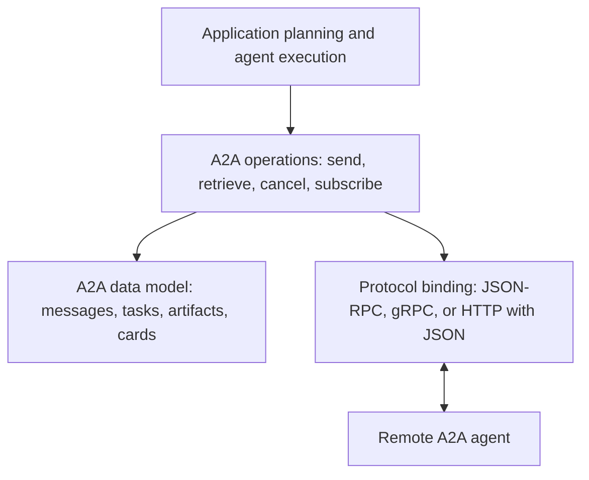
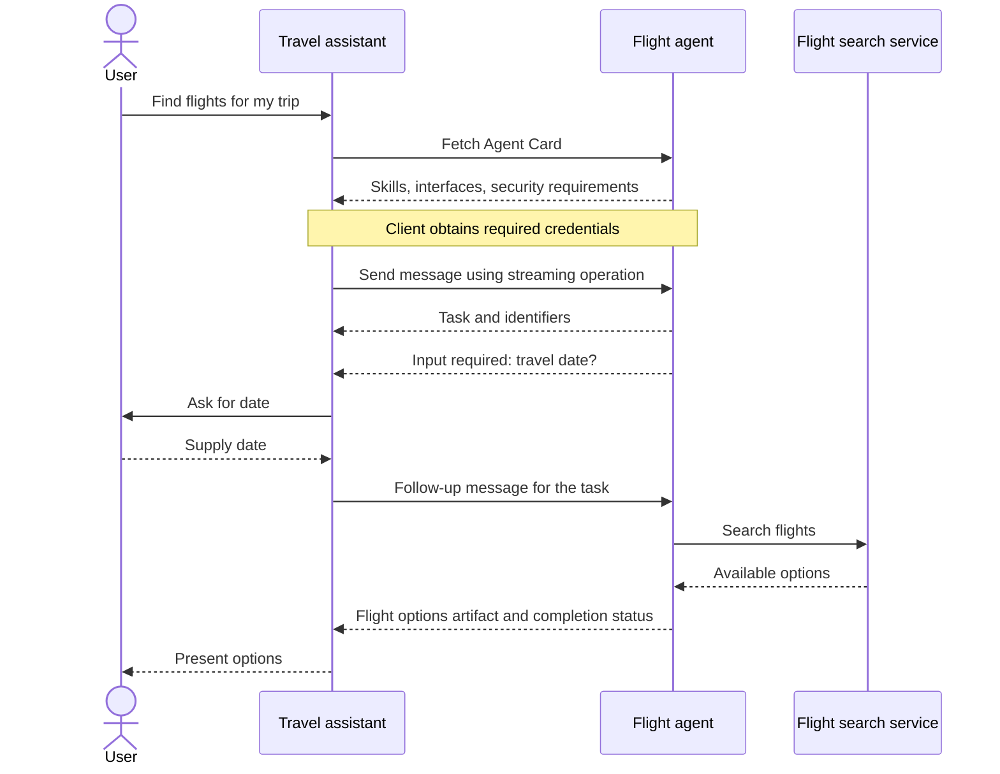
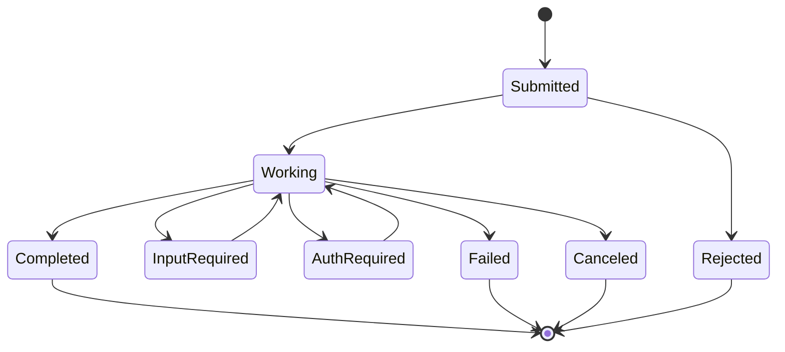
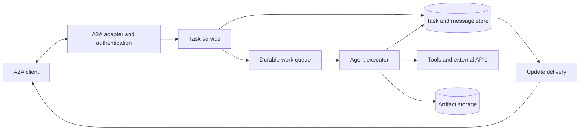

# A2A Architecture and Design

A2A, short for Agent2Agent, is an open protocol for collaboration between independent AI agents. It lets a client discover an agent, request work, and receive results without depending on the agent's internal framework, model, memory, or tools. A2A provides the communication contract; the application supplies planning and execution logic. [A2A overview](https://a2a-protocol.org/latest/)

This guide covers the protocol architecture and a proposed starting design for this repository. Protocol details target **A2A v1.0.0**, reviewed on **18 October 2026**. The implementation sections describe a future system.

## Why use A2A

Consider a travel assistant that coordinates a flight agent and a hotel agent. Each specialist owns its implementation and can evolve independently. A2A provides their shared communication interface. The travel assistant still decides which agents to call, how to combine results, and when to ask the user for a decision.

Use A2A when independently deployed agents need interoperability. A single service with a few internal functions can usually start with ordinary function calls.

## Protocol architecture

The specification separates three layers: a canonical data model, abstract operations, and concrete protocol bindings. Bindings include JSON-RPC, gRPC, and HTTP with JSON. They map the same underlying concepts onto different wire interfaces. [Specification architecture](https://a2a-protocol.org/v1.0.0/specification/#13-specification-structure)

An agent can serve requests from one peer and act as a client to another. These roles describe an interaction rather than fixed categories of agents. [Core concepts](https://a2a-protocol.org/latest/topics/key-concepts/)

## Core objects

| Object | Meaning | Travel example |
| --- | --- | --- |
| Agent Card | Metadata describing identity, interfaces, skills, capabilities, and security requirements | A flight agent advertises flight search |
| Message | One communication turn, with a role and content | Find flights from Delhi to Mumbai |
| Part | A content item inside a message or artifact | Text, structured data, or a file |
| Task | A tracked unit of work with state | Search for flights matching the request |
| Artifact | A task output | A structured list of flight options |
| Context | A grouping of related interactions | Searches belonging to the same trip |

A `messageId` identifies a message; a `taskId` identifies work; a `contextId` groups related interactions. Keep these purposes separate. A context identifier does not grant access to its contents. [Core concepts](https://a2a-protocol.org/latest/topics/key-concepts/), [Task lifecycle](https://a2a-protocol.org/latest/topics/life-of-a-task/)

## Discovery and trust

An agent can publish its card at `https://{domain}/.well-known/agent-card.json`. Clients can also use configured card locations or curated registries. A2A does not prescribe a standard registry API. [Agent discovery](https://a2a-protocol.org/latest/topics/agent-discovery/)

For this project's initial design, configure a small allowlist of agent domains. Fetch their cards, validate compatibility, and select a suitable skill. Treat a card as a capability declaration: separately establish trust in the provider and authorize each request. Keep credentials in a secret store and exclude them from cards and message content.

## Request and result flow

A server can return an immediate Message or create a Task for tracked work. A task may need more input or authorization before it can finish. Related follow-ups can share a context; terminal tasks remain closed, and refinements create new interactions. [Task lifecycle](https://a2a-protocol.org/latest/topics/life-of-a-task/)

The following sequence illustrates a proposed flight search using streaming:

Polling, streaming, and push notifications suit different clients. Polling retrieves task state periodically; streaming delivers incremental updates; push uses a client webhook for asynchronous notifications. Support depends on the agent's advertised capabilities. [Interaction mechanisms](https://a2a-protocol.org/latest/topics/key-concepts/)

## Task lifecycle

This simplified diagram shows common paths, using readable labels rather than wire enum names. It is not a complete transition specification.

Completed, failed, canceled, and rejected are terminal outcomes. Input required and authorization required interrupt execution and may allow continuation. Ending a stream does not by itself mean the task succeeded. [Task lifecycle](https://a2a-protocol.org/latest/topics/life-of-a-task/)

## A2A and MCP

| Interface | Main purpose | Example |
| --- | --- | --- |
| A2A | Communicate with an independent agent | Travel assistant delegates flight search |
| MCP | Connect an AI application to tools and resources | Flight agent queries an available search tool |

The two protocols can work together. A2A does not require MCP, and it does not define an agent's internal orchestration. [A2A and MCP overview](https://a2a-protocol.org/latest/#how-a2a-works-with-mcp)

## Proposed service design

Start with one client and one specialist agent. Use an official SDK compatible with the selected protocol version and one mutually supported binding. Add more agents after validating a complete interaction.

| Component | Responsibility |
| --- | --- |
| A2A adapter | Validate protocol requests and map responses through the SDK |
| Task service | Apply authorization, manage task state, and coordinate work |
| Agent executor | Run domain logic and translate outcomes into task updates |
| Task store | Persist messages, state, ownership, and artifact references |
| Work queue | Schedule execution and support recovery after worker failure |
| Artifact storage | Store large outputs with controlled access and retention |
| Update delivery | Publish committed status and artifact changes |

Keep protocol handling separate from domain logic so the same flight search implementation can be exercised without a network server. For a local demonstration, an in-process worker is sufficient; introduce a durable queue when tasks must survive process restarts.

### Persistence model

Use the following as internal storage entities, not as replacements for protocol schemas:

| Entity | Suggested fields |
| --- | --- |
| Context | ID, tenant, owner, creation time |
| Task | ID, context ID, state, revision, timestamps, execution lease |
| Message | ID, context ID, optional task ID, role, parts, receipt time |
| Artifact | ID, task ID, content or storage reference, media type, revision |
| Outbox event | Internal event ID, task ID, sequence, payload, delivery state |

Commit a task update and its outbox event in the same transaction. Deliver updates afterward so a crash cannot publish a state that was never saved. Use optimistic concurrency or a task lock to prevent competing workers from completing the same task differently.

### Reliability and failure handling

- **Duplicate sends:** Persist deduplication records scoped to the caller and message ID. A2A permits send deduplication but does not guarantee it; implement it explicitly. [Idempotency semantics](https://a2a-protocol.org/v1.0.0/specification/#331-idempotency)
- **Ambiguous timeouts:** Retrieve known task state before resending work that might create external side effects.
- **Worker crashes:** Use execution leases and checkpoints. Reconcile external actions before retrying them.
- **Disconnected streams:** Retrieve current task state and subscribe again when supported. Define replay behavior explicitly before depending on it.
- **Cancellation:** Signal the executor cooperatively, stop pending work, and record the outcome. Design compensation separately for actions already committed externally.
- **Slow dependencies:** Set deadlines, bounded retries with jitter, and per-agent concurrency limits.

### Security and observability

Authorize every task read, message, artifact download, and cancellation using tenant and caller identity. Limit which tools an executor can access. Treat remote text and files as untrusted inputs; validate structured results before using them to trigger actions.

If webhooks or remote file downloads are added, validate destinations, restrict network access, and authenticate callbacks. Avoid exposing secrets in logs. Record task IDs, internal trace IDs, state transitions, latency, retry counts, and dependency failures so operators can reconstruct an execution.

### Version compatibility

Pin the SDK version and verify its supported protocol version. Use generated SDK models rather than copying payloads from older tutorials: v1.0 changed wire details, including removal of the `kind` discriminator. The v1.0 JSON-RPC binding uses operation names such as `SendMessage` and `GetTask`. [Versioned specification and migration guidance](https://a2a-protocol.org/v1.0.0/specification/)

## Suggested implementation sequence

1. Expose a flight agent card with one narrowly defined search skill.
2. Connect a client and complete one request with a structured result.
3. Persist tasks and demonstrate a request that pauses for missing input.
4. Add streaming, then verify recovery after a disconnected client.
5. Add authentication, caller isolation, duplicate handling, and cancellation.
6. Add a hotel agent and let the client combine independent search results.

Validate behavior with scenarios that cross component boundaries: reject a task read by another caller; send the same message twice; restart a worker during execution; cancel while a tool is running; and continue a task after supplying missing information. Check protocol conformance against the pinned SDK and specification separately from domain accuracy.

## Design tradeoffs

| Choice | Benefit | Cost |
| --- | --- | --- |
| Configured agents first | Simple discovery and trust management | Manual onboarding |
| Polling first | Easy to implement and debug | Extra requests and delayed updates |
| Streaming | Responsive progress display | Connection and recovery complexity |
| Durable execution | Tasks survive process failure | Queue and persistence operations |
| Central coordinating agent | Clear workflow ownership | Coordinator can become a bottleneck |

A useful first milestone is a client delegating one durable task, supplying missing input, and retrieving a structured artifact after reconnecting. That exercises the main design boundaries before expanding the agent network.
